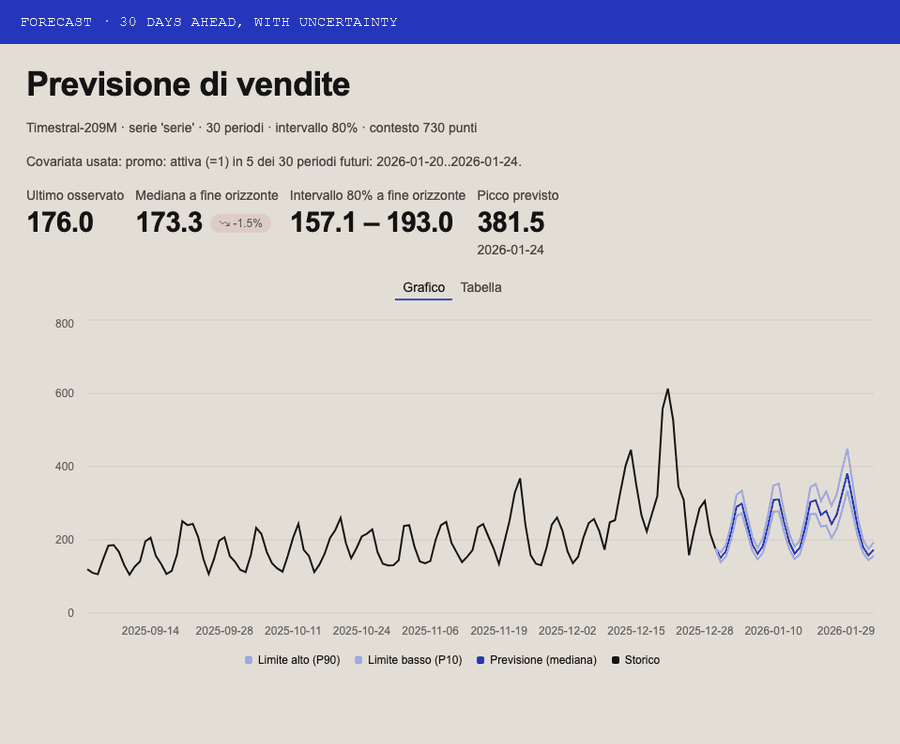
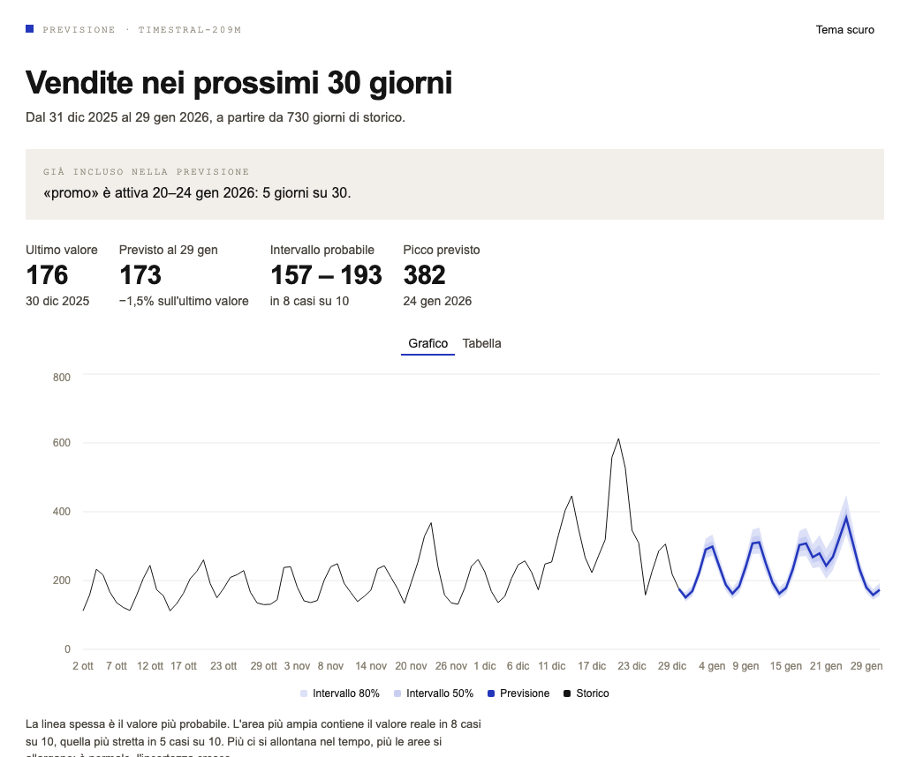
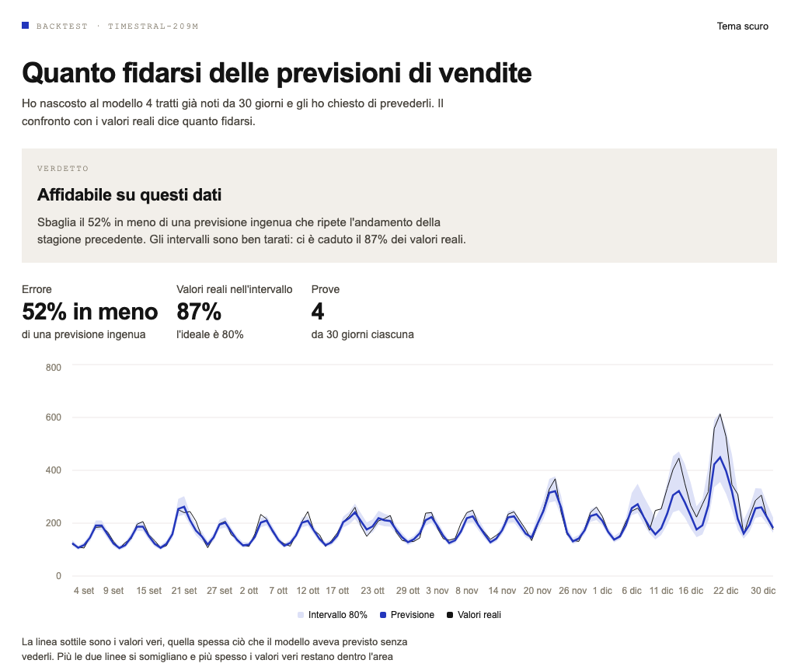
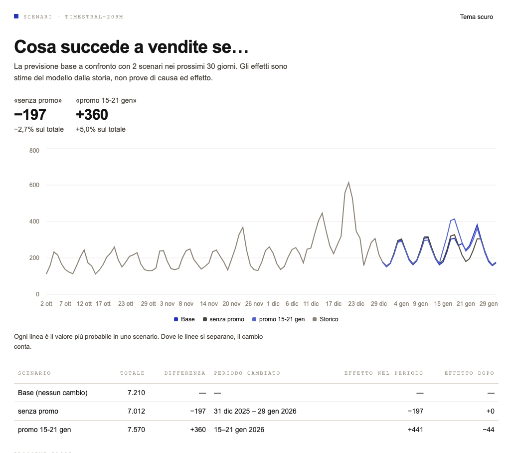
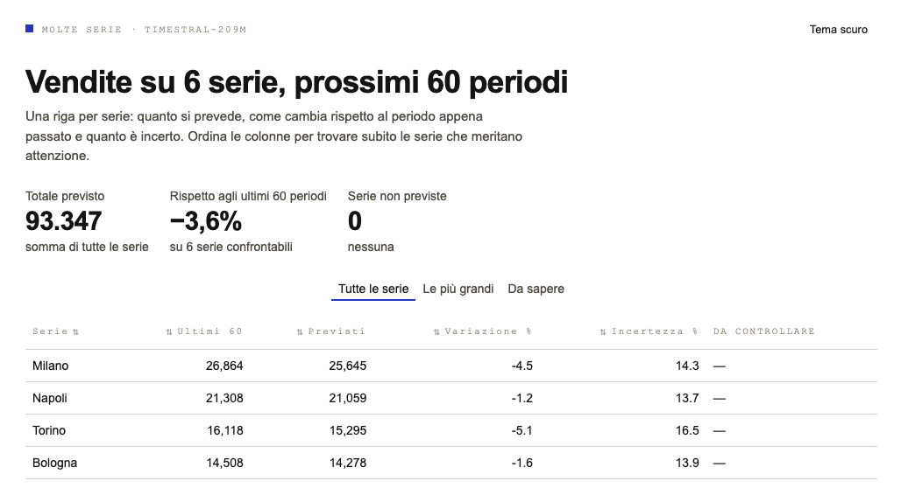
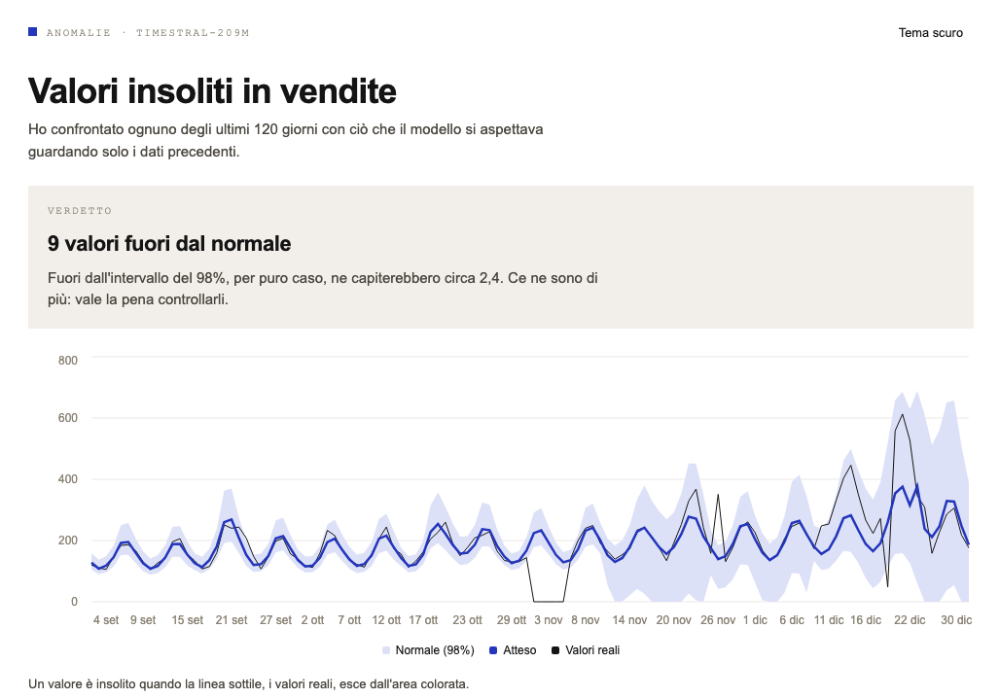
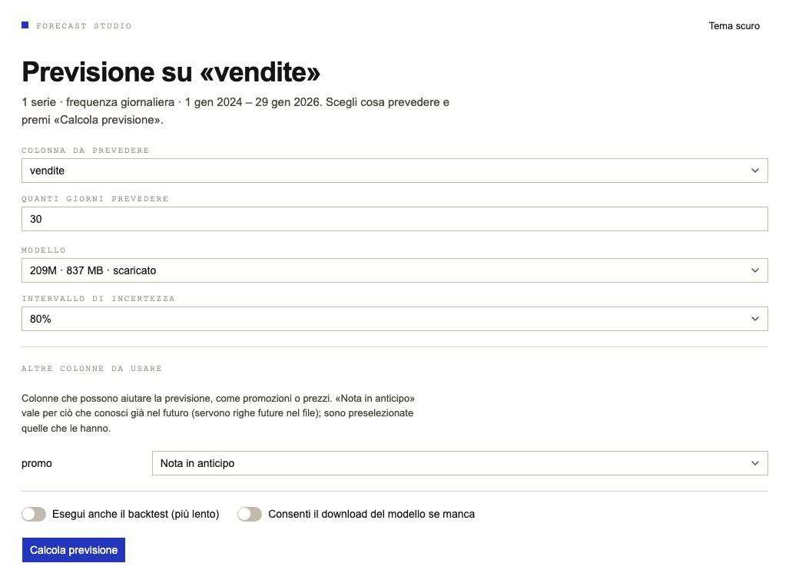
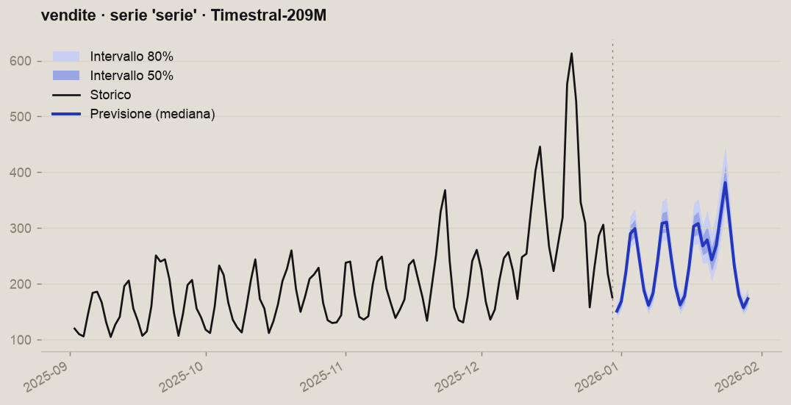
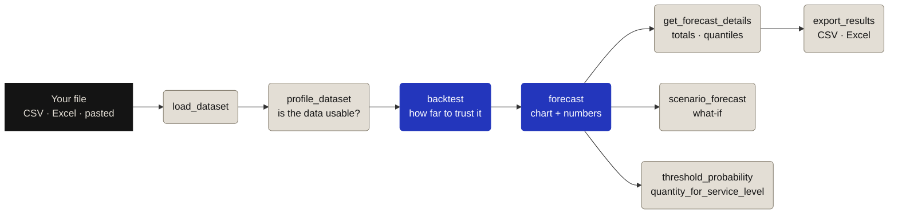

<picture>
  <source media="(prefers-color-scheme: dark)" srcset="brand/assets/banner-dark.svg">
  
</picture>

<p>
  
  
  
  
  
</p>

**Ask Claude about the future of your data, and get an honest answer.**
Timestral MCP connects Claude to Mistral's **Timestral** time series models. Point it at a CSV or Excel file and
Claude can check the data, test how reliable the model is on your history, forecast with uncertainty bands, run
what-if scenarios and spot anomalies, with interactive charts right in the chat. Everything runs on your machine.

<p align="center">
  
</p>

<p align="center"><sub>Real output of the server on the example file, with Timestral-209M. The apps currently speak Italian.</sub></p>

## Contents
[What you can ask](#what-you-can-ask) · [Quick start](#quick-start) · [See it in action](#see-it-in-action) ·
[How it works](#how-it-works) · [All tools](#all-tools) · [Configuration](#configuration) ·
[Limitations](#limitations) · [Development](#development)

## What you can ask

| You ask Claude… | The server | You get |
|---|---|---|
| *"Forecast sales for the next 30 days"* | `forecast` | An interactive chart with median and uncertainty band, and the numbers behind it |
| *"How much can I trust this forecast?"* | `backtest` | Error on past windows (MASE), comparison with a naive baseline, real coverage of the intervals |
| *"What if we run a promotion from the 15th to the 21st?"* | `scenario_forecast` | Base and alternative scenarios on one chart, with the difference in units |
| *"Forecast all six stores and tell me which ones worry you"* | `forecast_many` | One table for every series: change, uncertainty, flags, total |
| *"Did anything strange happen in the last four months?"* | `detect_anomalies` | Values outside the expected range, ranked by severity, with likely causes |
| *"How many units should I stock to cover 90% of cases?"* | `quantity_for_service_level` | The quantity per period and over the whole window, as a cautious range |
| *"What's the chance we drop below 150 a day?"* | `threshold_probability` | The probability for each period, from the model's quantiles |
| *"Which of my columns actually help the forecast?"* | `covariate_importance` | A verdict per covariate: useful, useless or uncertain |
| *"Total for January, please"* | `get_forecast_details` | Weekly, monthly or quarterly totals, with a warning on incomplete periods |

> [!TIP]
> Not sure where to start? Use the built-in prompt **`previsione_guidata`** (guided forecast) with the path of your file:
> Claude loads the data, checks it, runs a backtest and only then forecasts.

## Quick start

**1. Install** (needs [uv](https://docs.astral.sh/uv/))

```bash
git clone https://github.com/CalettiGabriele/Timestral-MCP.git
cd Timestral-MCP
uv sync
```

**2. Connect Claude Desktop.** Add this to `claude_desktop_config.json` (`~/Library/Application Support/Claude/` on macOS,
`%APPDATA%\Claude\` on Windows) and restart Claude Desktop:

```json
{
  "mcpServers": {
    "timestral": {
      "command": "uv",
      "args": ["run", "--directory", "/absolute/path/to/Timestral-MCP", "timestral-mcp"],
      "env": { "TIMESTRAL_DEFAULT_MODEL": "209M" }
    }
  }
}
```

Replace `/absolute/path/to/Timestral-MCP` with your clone. If Claude Desktop cannot find `uv`, use the full path printed by `which uv`.

**3. Ask.** Try the example file, two years of synthetic daily sales with a recurring promotion and 30 future rows
where the promotions are already planned:

> Use the "previsione_guidata" prompt with the file `/absolute/path/to/Timestral-MCP/examples/vendite_esempio.csv`.

<details>
<summary><b>About the model weights</b></summary>

Weights come from Hugging Face on first use (5M ≈ 21 MB, 28M ≈ 110 MB, 123M ≈ 490 MB, 209M ≈ 840 MB; no account needed).
**The server never downloads silently**: if a model is missing, Claude tells you its size and asks before retrying with
`allow_download=true`. To download ahead of time:

```bash
uv run timestral-mcp download 28M 209M
```

For faster answers on modest hardware, set `TIMESTRAL_DEFAULT_MODEL=28M`.
</details>

## See it in action

Every screenshot below is a real MCP app returned by the server, rendered from the example data with Timestral-209M.
Claude receives the same numbers as text, so it can answer follow-up questions without reading the chart.

### Forecast with uncertainty
> *"Forecast sales for the next 30 days, using the planned promotions."*



The model reads the planned promotion (20–24 January) as a known-in-advance covariate and expects the peak of the
month on the 24th. The band shows the 80% interval: wider where the model is less sure.

<table>
<tr>
<td width="50%" valign="top">

### Backtest: how far to trust it
> *"Before I use it, how good is it on my history?"*



Four past windows, each forecast only from earlier data: MASE 0.75 (52% better than a seasonal naive forecast),
and 87% of real values inside the nominal 80% interval.

</td>
<td width="50%" valign="top">

### What-if scenarios
> *"What if we also run a promotion from 15 to 21 January?"*



The extra week of promotion adds about 440 units in that week (+24%) and 360 over the month, with a small dip right
after it. Effects are the model's estimate from history, not proof of causality.

</td>
</tr>
<tr>
<td width="50%" valign="top">

### Many series at once
> *"Forecast the next two months for all six stores."*



One call, one table: expected total, change against the last 60 days, width of the uncertainty and flags for the
series that need a look. Drill into any store with `batch_series_forecast`.

</td>
<td width="50%" valign="top">

### Anomalies
> *"Did anything strange happen in the last four months?"*



Each value is compared with a forecast made only from the data before it. On this file it finds the five-day
stock-out, the unexplained spike and the data-entry error that were planted in it.

</td>
</tr>
</table>

### Forecast Studio and upload panel


Prefer clicking to typing? **`forecast_studio`** opens one screen where you choose the column, horizon, model,
interval and covariates, run the forecast (optionally with a backtest) and send the results back to Claude.
**`upload_dataset`** lets you drag and drop CSV or Excel files straight to the server, with nothing going through the chat.

No interactive apps in your client? `forecast_chart_image` returns the same forecast as a PNG:


<br clear="right">

## How it works



- **Zero-shot.** Timestral is not trained on your data: it reads the history and forecasts. Do not difference, impute or
  normalise the series first; the model handles missing values and scale on its own.
- **Probabilistic.** Every forecast has 21 quantiles, from 1% to 99%. The median is the central scenario, the bands say how
  wide the plausible range is.
- **Numbers, not pixels.** The chart is for you. Claude answers from the numbers each tool returns, so *"how much in
  March?"* gets an exact figure.
- **Skills included.** The server ships nine skills that teach Claude the method (backtest before trusting, how to explain
  uncertainty, how to read anomalies) plus a sales vertical (promotions, stock-outs, reporting).

## All tools

| Stage | Tool | What it does |
|---|---|---|
| **Data** | `load_dataset` | Reads a CSV/Excel file or pasted data; detects dates, frequency, series and value columns |
| | `upload_dataset` | Drag-and-drop panel (MCP app) to send files straight to the server |
| | `profile_dataset` | Quality checks: gaps, zeros, outliers, short history |
| | `add_calendar_features` | Holidays for any country, bridges, Black Friday, Christmas and Easter as known-in-advance covariates |
| **Trust** | `backtest` | Rolling-origin test: MASE, quantile loss, interval coverage, seasonal baseline |
| | `covariate_importance` | Which covariates help, by ablation, with a verdict per column |
| **Forecast** | `forecast` | Probabilistic forecast with interactive chart |
| | `forecast_studio` | One-screen form (MCP app) to set everything and run the forecast |
| | `scenario_forecast` | What-if on future covariates, compared with the base forecast |
| | `forecast_many` | Many series at once, with a summary table and attention lists |
| | `batch_series_forecast` | Drill into one series of a `forecast_many` result |
| **Decide** | `get_forecast_details` | Values per period, any quantile, weekly/monthly/quarterly totals |
| | `threshold_probability` | Probability of being above or below a threshold |
| | `quantity_for_service_level` | Quantity needed to cover a share of cases (e.g. stock) |
| | `detect_anomalies` | Values outside the expected range, each checked against a forecast from earlier data |
| **Share** | `export_results`, `export_batch` | Median and 21 quantiles to CSV/Excel |
| | `forecast_chart_image` | PNG chart for clients without interactive apps |
| | `list_session_items` | Datasets and results available in the session |

<details>
<summary><b>Skills, prompt and resources</b></summary>

- **Core skills:** `forecasting-workflow`, `timestral-specifics`, `forecast-interpretation`, `anomaly-investigation`, `covariate-selection`.
- **Sales skills:** `sales-forecasting`, `promotions-and-pricing`, `sales-anomalies`, `sales-reporting`.
- **Prompt:** `previsione_guidata` (file path and, optionally, a goal).
- **Resources:** `timestral://models` (which models are on disk), `dataset://{id}`, `forecast://{id}`.
- **App-only tools** (hidden from the model): `studio_run`, `studio_export`, `store_upload`.
</details>

## Configuration

<details>
<summary><b>Environment variables</b></summary>

| Variable | Default | Meaning |
|---|---|---|
| `TIMESTRAL_DEFAULT_MODEL` | `209M` | Model size used when none is specified (`5M`, `28M`, `123M`, `209M`) |
| `TIMESTRAL_DEVICE` | `cpu` | Torch device (`cpu`, `mps`, `cuda`) |
| `TIMESTRAL_PRELOAD` | `1` | Preload the default model at startup, only if already downloaded |
| `TIMESTRAL_EXPORT_DIR` | `~/TimestralMCP/exports` | Where exports are written |
| `TIMESTRAL_SKILLS_DIR` | project `skills/` | Skills folder |
| `TIMESTRAL_MAX_ROWS` | `2000000` | Maximum rows per file |
| `TIMESTRAL_MAX_UPLOAD_MB` | `25` | Maximum size of an uploaded file |
| `TIMESTRAL_MAX_BATCH_SERIES` | `100` | Maximum series per `forecast_many` call (the largest by recent volume are kept) |
| `TIMESTRAL_MAX_ANOMALY_WINDOWS` | `60` | Maximum forecast windows per `detect_anomalies` call |
</details>

## Limitations

> [!WARNING]
> This is **Milestone 1, a local MVP**: the server runs on your machine over stdio, with no cloud, login or Docker.

<details>
<summary><b>Details</b></summary>

- **Data sources:** local file path, uploaded file or pasted text. URLs and cloud buckets are planned.
- **Theme:** the MCP apps open in the light theme and have a button to switch to dark at any time; they do not follow the client theme.
- **MCP apps** (Forecast Studio, upload panel, charts) need a client that renders them (Claude Desktop, claude.ai, ChatGPT,
  VS Code…). Other clients get the same results as text. Rendering has not been checked visually in every client.
- **Calendar features** work on daily or finer data only; seasonal sales and paydays must be added to the file as 0/1 columns.
- **Long tools** (`backtest`, `forecast_many`, `detect_anomalies`, `covariate_importance`) run as MCP Tasks with progress on
  modern clients (15-minute budget). On the legacy protocol (e.g. Claude Desktop) they run synchronously within 90 seconds
  and report what they did not run. Tasks live in memory and do not survive a restart.
- **Totals and probabilities** over several periods are approximations from per-period quantiles; the tools say so and
  return ranges where an exact value cannot be computed.
- **Language:** the app interfaces and tool messages are currently in Italian.
</details>

## Development

```bash
uv run pytest -q          # tests (a fake model: no download)
uv run ruff check .       # lint
uv run ruff format .      # formatting
```

To regenerate the screenshots and the tour above (needs the model weights and Google Chrome):

```bash
uv run --with pillow python docs/tools/render_screenshots.py
```

Layout: `src/timestral_mcp/{data,analytics,ui}` (data, computation, interfaces), `server.py` (MCP tools), `studio.py`
(Forecast Studio and upload apps), `skills/` (core and verticals). Design and roadmap in [docs/design.md](docs/design.md);
visual identity in [brand/](brand/README.md).

---

<picture>
  <source media="(prefers-color-scheme: dark)" srcset="brand/assets/wordmark-dark.svg">
  
</picture>

<sub>Timestral is a family of models by Mistral AI. This project is independent and not affiliated with or endorsed by Mistral AI.</sub>
