<picture>
  <source media="(prefers-color-scheme: dark)" srcset="assets/banner-dark.svg">
  
</picture>

# Visual identity

One visual system for the documentation, the MCP apps (Forecast Studio, upload panel, charts) and a future website.
Open [`preview.html`](preview.html) in a browser to see every asset and token in context.

> [!NOTE]
> Timestral is a family of models by Mistral AI. This project is independent and not affiliated with or endorsed by Mistral AI. The identity borrows a formal idea from Mistral's stacked pixel stripes, never its logo, name styling or colours.

## The idea

**Less noise. More signal.** A forecaster takes a noisy history and returns a signal with an honest measure of its uncertainty. The identity draws exactly that:

| Element | What it is | Why |
|---|---|---|
| Ultramarine panel | A flat square in ultramarine with a white hand-drawn trace | The house panel: calm, editorial, unmistakable |
| Jittery trace | The history, drawn as a shaky white line | Real data is noisy; the trace is never a perfect curve |
| Vertical stroke | The "now" line | Where history ends and the forecast begins |
| Pixel fan | Columns of squares that widen to the right, in five ultramarine tints | The quantile fan. Five stacked bands nod to Mistral's striped pixel mark, re-coloured in the house accent |

## Assets

All in [`assets/`](assets). They are generated by [`tools/generate.py`](tools/generate.py) (standard library only, seeded): edit the script, not the SVGs.

```bash
uv run python brand/tools/generate.py
```

| File | Use |
|---|---|
| `banner-light.svg`, `banner-dark.svg` | README hero (animated, respects `prefers-reduced-motion`) |
| `mark.svg`, `mark-animated.svg` | The panel on its own: avatars, app headers, slides |
| `wordmark-light.svg`, `wordmark-dark.svg` | Lockup for docs headers and footers |
| `favicon.svg` | Browser tabs and very small sizes (simplified, no jitter) |
| `social-preview.svg` | GitHub social preview (export to PNG 1280×640 before uploading) |

In Markdown, switch light/dark with `<picture>`:

```html
<picture>
  <source media="(prefers-color-scheme: dark)" srcset="brand/assets/banner-dark.svg">
  
</picture>
```

## Colour

Warm neutrals do the work; **one accent, ultramarine, used only to carry information** (the current step, the median, the primary action). Never two accents in the same view.

| Token | Hex | Role |
|---|---|---|
| `ink` | `#141414` | Text, history line, dark background |
| `graphite` | `#4A463F` | Secondary text |
| `stone` | `#8A8375` | Labels, muted text, actuals |
| `sand` | `#C2BAAC` | Borders |
| `linen` | `#D9D2C7` | Surfaces |
| `paper` | `#E3DED5` | Background (light) |
| `ultramarine` | `#2336BC` | The accent: panel, median, primary action |
| `ultramarine-500 … 50` | `#3E4FC8` `#5464CC` `#9AA5E4` `#C9CFF2` `#DDE1F7` | Quantile bands only, from outer to inner |
| `signal-red` | `#BC2323` | Anomalies and errors only |

On dark backgrounds ultramarine text becomes `ultramarine-200` for contrast; the panel stays ultramarine.

## Type

| Role | Face | Use |
|---|---|---|
| Display | Arial Bold, tight tracking, lowercase for the name | Titles, statements, the wordmark |
| Body | Calibri (fallback Carlito, Segoe UI) | Running text |
| Label | Courier New, UPPERCASE, wide tracking | Micro-labels, section kickers, chart axes |

The name is always written **timestral**, lowercase, in one piece.

## Rules

- **The panel** appears on covers, editorial moments and closings: the README hero, the app header, the end of a page. Not as decoration on every section.
- **The full stroke** (4 px rule) belongs to identity blocks. Never use it to underline a section title.
- **Square corners.** No rounded cards, no shadows, no gradients.
- **Charts** use the chart tokens: history in ink, median in ultramarine, bands in the ultramarine tints, actuals in stone.

## Tokens

| File | For |
|---|---|
| [`tokens/tokens.json`](tokens/tokens.json) | Source of truth |
| [`tokens/tokens.css`](tokens/tokens.css) | Website and HTML pages (`--tm-*` variables, light and dark) |
| [`tokens/prefab-theme.css`](tokens/prefab-theme.css) | Reference of the Prefab/shadcn variables, light and dark |
| [`src/timestral_mcp/ui/theme.py`](../src/timestral_mcp/ui/theme.py) | The theme the MCP apps actually use (`THEME`), plus the PNG chart colours. `tests/test_theme.py` checks it matches `tokens.json` |
